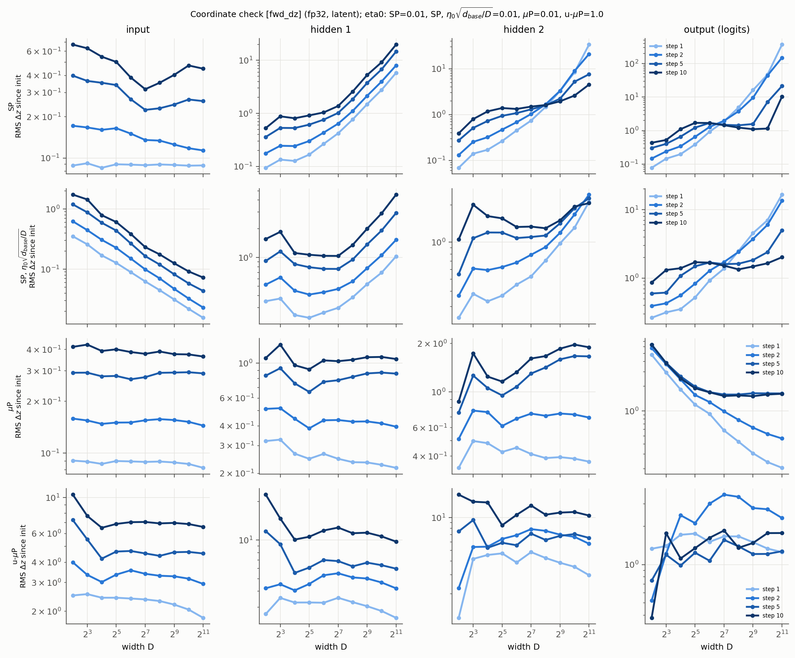
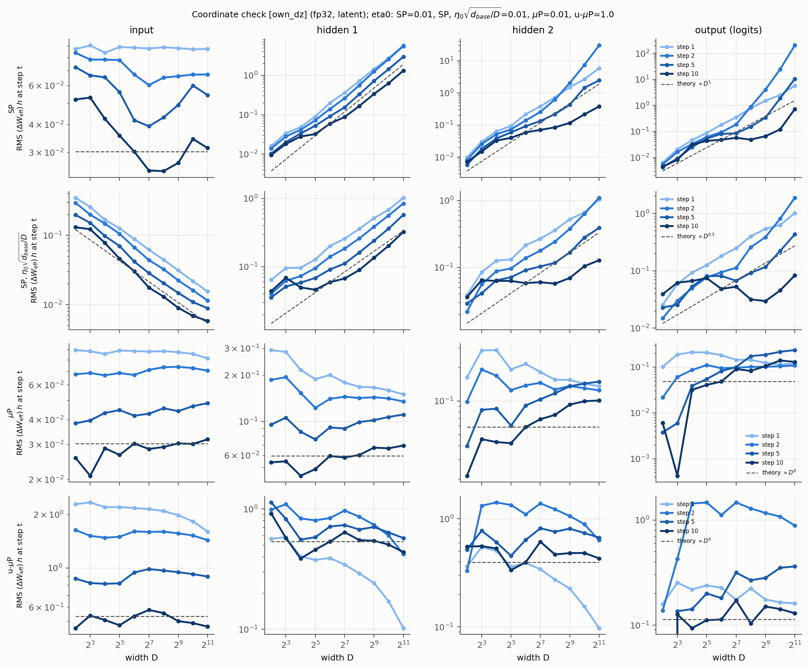
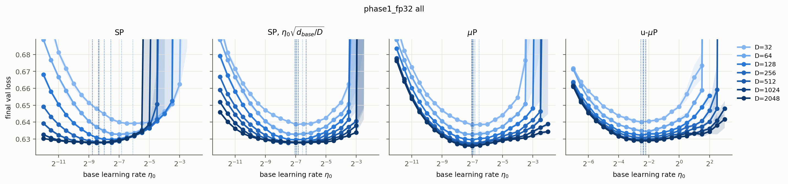
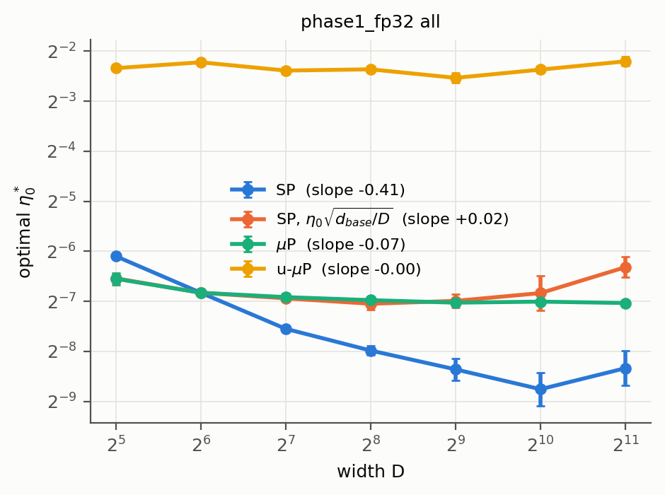
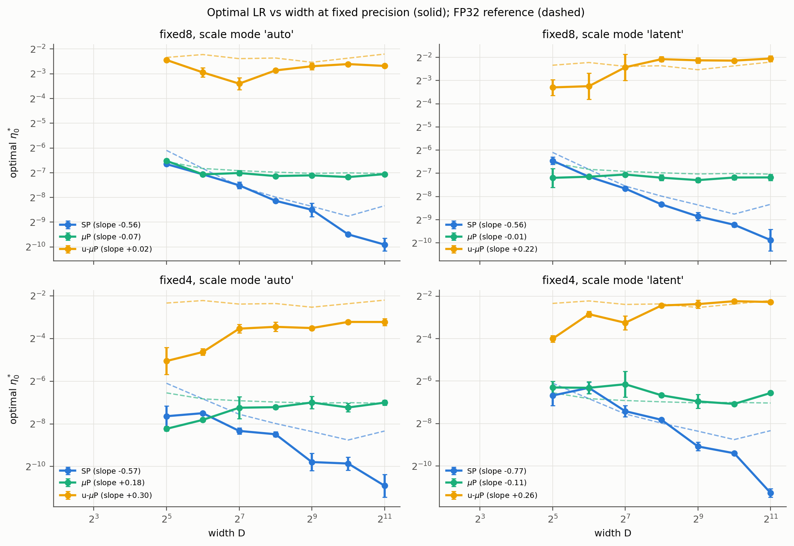
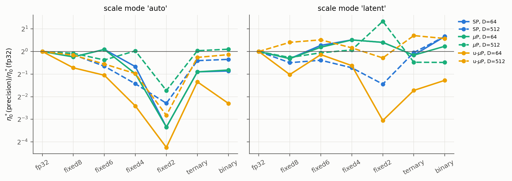

# Hyperparameter transfer across width and numerical precision

**Does the optimal learning rate (LR) found on a small network carry over to wider networks and to
quantised (QAT) versions of the same network?** This repo compares the standard parametrisation (SP)
with μP and u-μP on the hls4ml jet-tagging dataset. Networks run in full precision (FP32) and with QKeras
quantisation-aware training (fixed-point 8/6/4/2 bit, ternary, binary). The optimiser is Adam throughout.

- **Q1, transfer across precision:** tune the LR in FP32, then train the QAT version. Does the optimum stay put?
- **Q2, transfer across width:** tune a small (quantised) network, then scale the width up. Do the
  μP / u-μP scaling rules still hold under (extreme) quantisation?
- **Finite-width effects:** μP guarantees transfer only in the infinite-width limit. Below which width
  does it break down?

Motivation: hyperparameter optimisation is expensive, especially when scanning many architectures and
quantisation schemes, e.g. for FPGA deployment with hls4ml. If the LR transfers, it can be tuned once on
a small FP32 proxy.

---

## Contents
1. [Setup](#setup)
2. [Method](#method)
3. [Running](#running)
4. [Results](#results)
5. [Baseline: published performance on this dataset](#baseline-published-performance-on-this-dataset)
6. [Caveats](#caveats)
7. [Repository layout](#repository-layout)
8. [References](#references)

---

## Setup

```bash
conda env create -f environment.yml      # python 3.10, TF 2.14, QKeras 0.9.0 (CPU is enough)
conda activate hpt
python -m hpt.data                        # downloads OpenML 42468 -> data/jets_hlf.npz
pytest tests                              # unit tests (parametrisation rules, quantisers, LR groups, AUC)
python -m hpt.train --arm mup --width 256 --eta0 0.008 --precision fixed4 --sweep debug
```

**Data.** [hls4ml_lhc_jets_hlf](https://www.openml.org/search?type=data&id=42468) (OpenML 42468):
- 830k jets, 16 high-level jet-substructure features, 5 classes (gluon, light quark, top, W, Z).
- Stratified 70/10/20 train/val/test split (seed 42); features standardised on the train split.
- LR selection uses the validation set; the test set is only used for the final performance plots.

---

## Method

### Architecture
```
16 inputs -> [D] -> [D] -> [D] -> 5 logits      (ReLU, softmax cross-entropy, no BN/dropout)
```
- All three hidden layers share the same width D. The depth is fixed; only D is scaled.
- Widths range over D = 4 … 2048, i.e. 2.8k (D=32) to 8.4M (D=2048) parameters.
- Base width d_base = 64, the hls4ml reference width. At D = 64, SP, SP-√D and μP are the identical network.

### Parametrisations (`hpt/parametrization.py`)
Each layer computes `y = multiplier · (x @ Q(W)) + b`, with `W ~ N(0, std²)` and Adam LR = `η0 · lr_mult`:

| arm | input (16→D) | hidden (D→D) | output (D→5) |
|---|---|---|---|
| `sp` (standard) | std 1/√16, LR η0 | std √2/√D, LR η0 | std 1/√D, LR η0 |
| `sp_sqrtD` | as SP, all LRs × √(d_base/D) | | |
| `mup` (μP, Tensor Programs V) | as SP | std √2/√D, **LR η0·d_base/D** | std 1/√D, **mult d_base/D**, LR η0 |
| `umup` (u-μP, Blake et al.) | std 1, mult 1/√16, LR η0 | std 1, **mult √2/√D, LR η0/√D** | std 1, **mult 1/D**, LR η0 |

- Biases are zero-initialised with LR η0 (× √(d_base/D) in `sp_sqrtD`).
- `sp_sqrtD` tests the simple hypothesis η ∝ 1/√D.
- Ablation flags: `--readout-zero-init`, and `--umup-input-lr fan_out` (the u-μP paper's input rule).

### Quantisation (`hpt/quant.py`, QKeras)
Weights are quantised as `W_q = s · Q(W/s)`, where `Q` is a unit-format QKeras quantiser (`quantized_bits(b,0)`, `ternary`, `binary`) with straight-through gradients.
- **`--scale-mode latent`** ("frozen grid"): s is a power of two, chosen once at the base width (MSE-optimal for that layer's initial weights) and kept for all widths. This models a fixed `ap_fixed` format chosen in advance. Under SP/μP the weights shrink like 1/√D, so the grid becomes relatively coarse at large D; under u-μP the weights stay at unit scale.
- **`--scale-mode auto`**: QKeras `alpha="auto_po2"` (fixed point) or `"auto"` (ternary/binary). A per-channel power-of-two scale is recomputed from the current weights.
- **Activations:** `quantized_relu(b)` with a fixed power-of-two range.
- **Biases:** at least 8 bits.
- **`ternary`/`binary` precisions:** only the hidden layers are ternary/binary. The input/output layers and activations are 8-bit. `fixed2` means 2-bit weights *and* 2-bit activations.
- **`--range-mode calib`** takes ranges from a trained FP32 model (ablation). It is worse at 4 bits.

### Training protocol
- Adam (β = 0.9/0.999, ε = 1e-8), batch 1024, 15 epochs (8505 steps).
- Schedule: 5% linear warm-up, then cosine decay to 10%.
- No weight decay and no early stopping. All widths use identical conditions.
- One Adam instance per LR group.

### Measurements
- Final validation cross-entropy is the primary metric. It is more sensitive than accuracy, which saturates around 77%.
- Optimal LR η0*: a parabola is fitted in log₂ η0 through the 5 grid points around the minimum of the seed-averaged loss. Its uncertainty is estimated by bootstrapping over seeds.
- Transition rate: the fraction of quantised weights that change level per step (Lee et al., ICCV'25).
- Test accuracy and macro one-vs-rest ROC AUC.
- Coordinate checks of the forward and backward pass.

---

## Running

### Single run / local
```bash
python -m hpt.train --arm umup --width 512 --precision fixed4 --scale-mode latent --eta0 0.2 \
    --seed 0 --epochs 15 --evals-per-epoch 2 --eval-test --sweep mysweep
# -> results/mysweep/<run_id>.json   (config, curves, final metrics, AUC, transition rates)
python -m hpt.coord_check --precision fp32           # forward + backward coordinate checks
```

### Sweeps on HTCondor (lxplus)
```bash
python sweeps/make_sweep.py configs/phase1_fp32.json   # LR x width x seed grid -> sweeps/phase1_fp32.args
condor/submit.sh sweeps/phase1_fp32.args               # one job per ~5 h chunk of runs
python sweeps/make_transfer_eval.py                     # performance runs at transferred / own eta*
```
- **Re-runnable:** sweep generation skips runs whose result JSON already exists, so re-running `make_sweep` + `submit.sh` fills in failed runs.
- **Chunk size and slot class:** set with `HPT_CHUNK_H` and `HPT_FLAVOUR`.
- **Site settings:** copy `condor/site.env.example` to `condor/site.env` and set the project path, the xrootd URL and the env tarball.
- **lxplus specifics:**
  - Standard schedds refuse `/eos` paths in submit files, so `submit.sh` copies the launcher and job list to `$HPT_LOGDIR` on AFS.
  - About 100 jobs importing TensorFlow from a conda env on EOS at once fail with `EIO`. The environment is therefore packed with `conda-pack` into `env/*.tar.gz`, and each job copies it (and the dataset) to local scratch with `xrdcp`.

  To build the tarball:
  ```bash
  pip install --target /tmp/cpack conda-pack
  PYTHONPATH=/tmp/cpack python -c "import sys; from conda_pack.cli import main; \
    sys.argv=['conda-pack','-n','hpt','-o','env/hpt-env.tar.gz']; main()"
  ```
- **Timing on 4-core slots, 15 epochs:** D=64 ≈ 1 min, D=1024 ≈ 15 min, D=2048 ≈ 1 h; quantised runs are about 1.3× slower.

### Analysis
```bash
python -m analysis.analyze phase1_fp32          # transfer curves, eta* vs width, transfer degradation
python -m analysis.phase2_summary               # Q2 summary: eta* vs width per precision, transition rates
python -m analysis.precision                    # Q1: FP32 -> QAT at D = 64, 512
python -m analysis.transfer_eval                # test acc / AUC vs width, time-to-threshold
python -m analysis.finite_width                 # finite-width breakdown, source->target heatmaps
```
Per-sweep summary tables are in `results/<sweep>.csv` (one row per run); the raw JSONs are not in git.

| sweep | content | runs |
|---|---|---|
| `phase0_pilot` | FP32, 4 arms, D ∈ {64, 1024}, coarse LR grid | 136 |
| `phase1_fp32` | FP32, 4 arms, D = 32…2048, 21 LRs (2^0.5 steps), 3 seeds | 1764 |
| `phase2_pilot` | fixed8/4 × latent/auto, SP/μP/u-μP, D ∈ {64, 1024}, coarse | 408 |
| `phase2_fixed` | fixed8/4 × latent/auto, SP/μP/u-μP, D = 32…2048, 21 LRs, 2 seeds | 3528 |
| `phase3_precision` | fixed6/2, ternary, binary × latent/auto, D ∈ {64, 512}, 2 seeds | 2016 |
| `phase5_small_width` | D ∈ {4, 8, 16}, FP32 (5 seeds) and fixed8/4 (3 seeds), 25 LRs | 4200 |
| `transfer_eval` | η* tuned at D=32 vs own η*, D = 4…2048, test acc/AUC, half-epoch checkpoints | ~800 |

---

## Results

### Coordinate checks (forward and backward pass)
These record per-layer RMS quantities during the first 10 Adam steps against width, at a fixed η0 (`plots/coord_check/`). A parametrisation that transfers should give curves that are **flat in D**.

| | |
|---|---|
|  |  |
| Forward: change of pre-activations since init. | Backward: change of each layer's output caused by its **own** weight update; the dashed line is the theory (SP ∝ D, μP/u-μP flat). |

- **SP:** hidden-layer and logit updates grow ∝ D, which is why its optimal LR drifts down with width.
- **SP-√D:** halves the slopes but over-corrects the input layer.
- **μP and u-μP:** flat.
- **4-bit frozen grid (`*_fixed4_latent.png`):** u-μP hidden-layer updates fall off at large D. Its weight step shrinks as η0/√D while the grid step is fixed, so fewer weights change level.
- **Other plots in the folder:** gradient RMS (`grad_rms_*`), effective update RMS (`upd_rms_*`) and backward signal ∂L/∂z (`bwd_signal_*`) for FP32, fixed8 and fixed4.

### Q2 in FP32: width transfer (Phase 1)


Each panel is a parametrisation and each curve a width (light = narrow, dark = wide). The dotted lines mark the fitted optimum. Transfer means the valleys line up.



| | slope of log₂ η0* vs log₂ D | best val loss at D=2048 |
|---|---|---|
| SP | −0.41 | 0.6279 |
| SP-√D | +0.02 (drifts up at D ≥ 1024) | 0.6279 |
| μP | −0.07 | **0.6257** |
| u-μP | 0.00 | 0.6289 |

- **SP's optimum drifts** roughly as 1/√D, and its divergence edge moves to smaller LR.
- **μP and u-μP transfer.** Under μP, "wider is better" at every LR. SP and SP-√D stop improving beyond D ≈ 256.
- **The basins are flat:** the loss penalty for a mistuned LR is small (≤ 0.002) on this dataset.

### Q2 at fixed precision (Phase 2)


| slope of η0* vs D | SP | μP | u-μP |
|---|---|---|---|
| FP32 | −0.41 | −0.07 | 0.00 |
| fixed8, frozen grid | −0.56 | −0.01 | +0.22 |
| fixed8, auto | −0.56 | −0.07 | +0.02 |
| fixed4, frozen grid | −0.77 | −0.11 | +0.26 |
| fixed4, auto | −0.57 | +0.18 (flat from D ≥ 128) | +0.30 |

- **μP keeps transferring at 8 and 4 bits** (e.g. `plots/phase2_fixed/curves_final_val_loss_fixed4_latent.png`).
- **SP's drift gets worse under quantisation.** Using the D=64 LR at D=2048 costs up to 0.025 in loss (fixed4, frozen grid).
- **u-μP's optimum rises with width at low precision**, roughly as D^+0.25. Small quantised u-μP networks need a smaller LR.
- **Transition rate:** the fraction of weights changing level per step falls roughly as 1/√D … 1/D for *all* parametrisations (`summary_transition_rate_vs_width.png`), including μP, which still transfers. So "keep the transition rate width-invariant" is not the right scaling rule.

### Q1: FP32 → QAT at fixed width (Phase 3)


The plot shows η0*(precision) / η0*(FP32) at D = 64 (solid) and 512 (dashed).
- **μP:** the FP32 LR transfers to fixed8/6/4, ternary and binary within about 1.5×. At D=512 using it costs ≤ 0.0002 in loss.
- **u-μP and SP (auto scale):** the optimum drops with the bit width. For u-μP at D=64 the ratio goes 0.61 → 0.48 → 0.19 for 8 → 6 → 4 bits. These need a precision-dependent correction.
- **Quantisation mainly moves the divergence edge to smaller LR, about one octave** (`curves_D512_auto.png`), rather than moving the optimum.
- **fixed2 (W2A2)** transfers for no parametrisation.

### Performance vs width with the LR tuned at D=32 (`transfer_eval`)
*Running; plots will be in `plots/transfer_eval/`:*
- `perf_test_acc.png`, `perf_test_auc.png`: test accuracy and macro AUC vs width, using the η0* tuned at D=32 (solid) vs each width's own η0* (dashed), with literature baselines.
- `time_to_acc_0.76.png`, `time_to_acc_0.769.png`, `time_to_auc_0.94.png`: epochs until the validation metric first reaches the baseline, vs width.

### Finite-width effects (`phase5_small_width`)
*Running; plots will be in `plots/finite_width/`:*
- `eta_ratio_vs_width.png`: deviation of η0*(D) from its large-width value for D = 4…2048, with the breakdown width D_c.
- `transfer_heatmap_*.png`: penalty for tuning at width s and training at width t.

---

## Baseline: published performance on this dataset
Our wide FP32 models reach 77.3–77.5% validation accuracy, at or slightly above the best published number for the OpenML version.

| paper | model / precision | accuracy | AUC | data version |
|---|---|---|---|---|
| Duarte et al. 2018 (1804.06913) | 16-64-32-32-5, FP / ⟨16,6⟩ | ~75% | g .938, q .904, W .946, Z .939, t .958 | Zenodo |
| Coelho et al. 2021, QKeras (2006.10159) | 16-64-32-32-5 + BN, 6-bit QAT | 74.8% | t .96, g .94 | Zenodo |
| Hawks et al. 2021, Ps&Qs (2102.11289) | FP32 / 6-bit QAT | 76.98% / 76.74% | mean .943 / .942 | Zenodo |
| Andronic & Constantinides 2025 (2504.00592) | float FC reference | 77.0% (OpenML), 76.0% (CERNBox) | – | both |
| Sun et al., HGQ (2405.00645 v3) / da4ml (2507.04535) | mixed precision 16-64-32-32-5 | 76.9% | – | OpenML |
| Di Guglielmo et al. 2020 (2003.06308) | best binary / ternary | 72% | – | Zenodo |

The OpenML version reaches about 1 point higher accuracy than the Zenodo/CERNBox version.

Thresholds used for the time-to-threshold study:
- **76.0%** (6-bit QAT / CERNBox-float level);
- **76.9%** (best published 16-64-32-32-5);
- **macro AUC 0.940**.

---

## Caveats
- **η0* noise is about ±0.5 octave**, partly from basins being flat on this dataset. At D=64, SP and μP are the identical network, but multi-threaded TF is not bit-reproducible, and their quantised η0* differ by up to 0.5 octave. Smaller shifts are not significant.
- **u-μP leaves unit scale during training.** At η0* ≈ 0.2 (D=64) the hidden pre-activation RMS is about 13, biases reach about ±20 and input weights reach RMS about 7. Fixed-range quantisers therefore cost u-μP more than μP. A likely contributor is our width-independent input LR (the u-μP paper uses η/√fan_out; ablation flag available).
- **`fixed2` is W2A2; `ternary`/`binary` are weight-only with 8-bit activations.** They are different regimes, not a bit-width ranking.
- **Time-to-threshold** is measured inside the fixed 15-epoch cosine schedule.

---

## Repository layout
```
hpt/            core package
  data.py          download/split/standardise OpenML 42468
  parametrization.py  per-layer init / multiplier / LR rules (SP, SP-√D, μP, u-μP)
  quant.py         QKeras quantisers (frozen-grid / auto scale), transition-rate codes
  layers.py        ScaledQDense layer
  model.py         MLP builder
  train.py         one training run -> JSON (CLI)
  coord_check.py   forward/backward coordinate checks
sweeps/         make_sweep.py (LR grids), make_transfer_eval.py (performance runs)
configs/        sweep definitions (JSON)
condor/         HTCondor launcher (run.sh), submit.sh, sweep.sub, site.env.example
analysis/       analyze.py, phase2_summary.py, precision.py, transfer_eval.py, finite_width.py, style.py
results/        per-sweep summary CSVs (raw per-run JSONs are not tracked)
plots/          all figures
tests/          pytest unit tests
```

---

## References
- G. Yang et al., *Tensor Programs V: Tuning Large Neural Networks via Zero-Shot Hyperparameter Transfer* (μP), arXiv:2203.03466.
- C. Blake et al., *u-μP: The Unit-Scaled Maximal Update Parametrization*, arXiv:2407.17465.
- S. Narayan et al., *μnit Scaling: Simple and Scalable FP8 LLM Training*, ICML 2025.
- J. Lee et al., *Scheduling Weight Transitions for Quantization-Aware Training*, ICCV 2025.
- Vlassis et al., *Beyond Outliers: A Study of Optimizers Under Quantization*, arXiv:2509.23500.
- Panferov et al., *Unified Scaling Laws for Compressed Representations*, NeurIPS 2025.
- Volkova et al., *Towards Robust Scaling Laws for Optimizers*, arXiv:2602.07712.
- J. Duarte et al., *Fast inference of deep neural networks in FPGAs for particle physics*, arXiv:1804.06913.
- C. Coelho et al., *Automatic heterogeneous quantization of deep neural networks…* (QKeras), arXiv:2006.10159.
